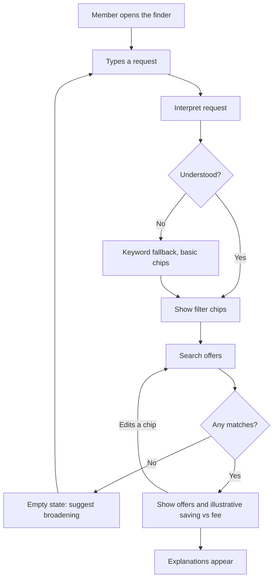
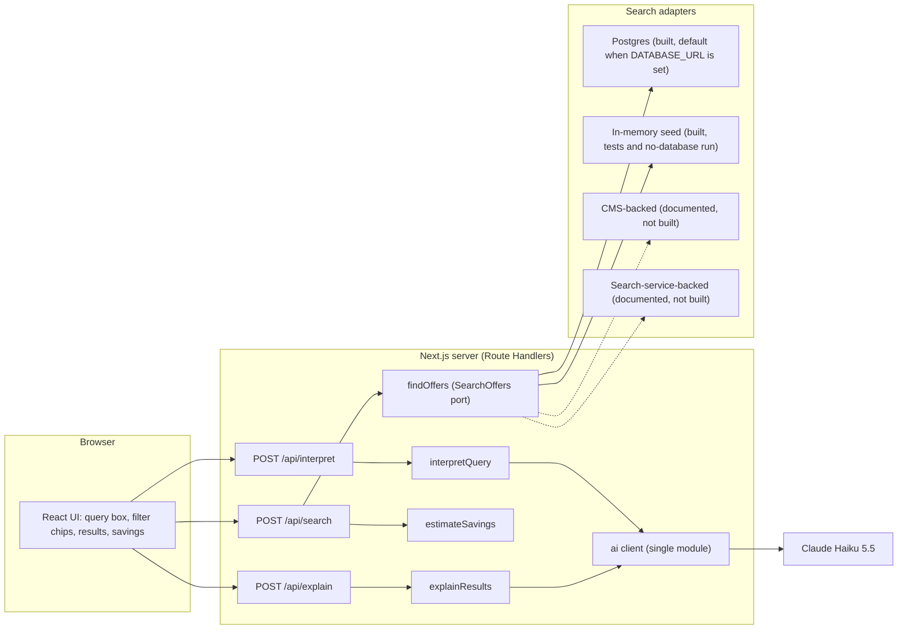
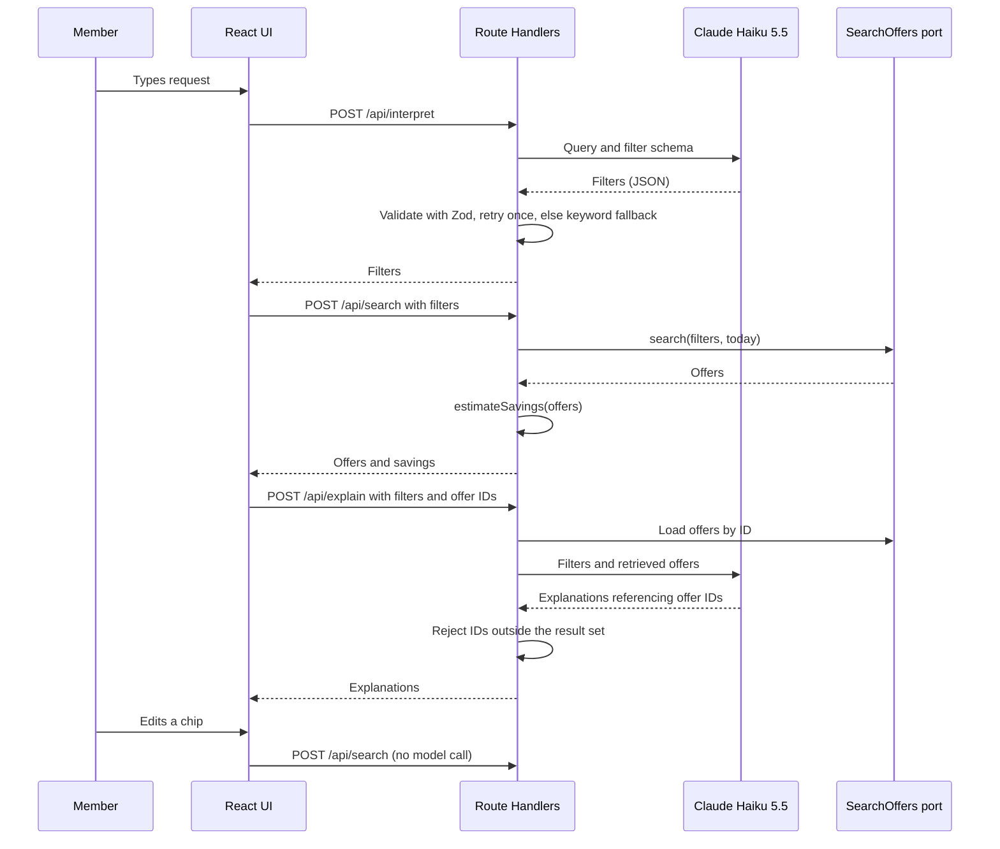

# Architecture

How the finder is built and why. Decisions are recorded in [docs/adr](adr/README.md); this document describes the resulting design.

## Overview

A member types a request in natural language. The app interprets it into editable filters, searches a catalogue deterministically, shows matches with an illustrative saving against the membership fee, and adds short explanations.

The language model only **translates** the query into filters and **explains** results it was given. It never supplies offers, prices or savings ([ADR-002](adr/002-ai-boundary.md)).

## User flow



## System design



## Request flow



## Layers

| Layer | Responsibility | Depends on |
|---|---|---|
| UI (`src/app`) | Input, chips, results, savings, loading, empty and error states | API contracts only |
| Route Handlers (`src/app/api`) | Validate input, orchestrate, shape responses | services |
| Services (`src/services`) | `interpretQuery`, `explainResults`, `findOffers` (calls the `SearchOffers` port) | domain, `lib/ai`, and `data` only for the adapter-selection entry point (`@/data`) |
| Domain (`src/domain`) | Types, Zod schemas, the `SearchOffers` port (an interface only), `estimateSavings`, grounding check. Pure | nothing |
| AI client (`src/lib/ai`) | The only module that calls the model; mock provider for tests | provider SDK |
| Data (`src/data`) | Fictional sample catalogue and the adapters that implement the port (Postgres, in-memory), plus the one place that picks an adapter from the environment | domain, `lib/env` (adapter selection reads `DATABASE_URL`) |

Dependencies point inward: domain depends on nothing, and only `lib/ai` knows the provider. Next.js-specific conventions (server-only modules, env access, route states) are in [ADR-009](adr/009-nextjs-conventions.md); the import boundaries above are enforced by Oxlint.

## Folder structure

Target layout. Folders are created when they get content ([ADR-009](adr/009-nextjs-conventions.md) rule 2), so only `src/components/` (when a second route needs it) does not exist yet. Parts marked *proposal* go beyond ADR-009 and are confirmed in the plan of the phase that builds them.

```text
boundless-tech-test/
|-- .agents/skills/              task workflow skills (exists); .claude/skills links here
|-- .github/workflows/ci.yml     typecheck, lint, unit, e2e, integration (Postgres service)
|-- db/migrations/               plain SQL migrations, applied by node-pg-migrate
|-- docs/                        brief, adr, research, design, architecture, roadmap, TODO (exists)
|-- e2e/                         Playwright: two happy-path specs, run by `pnpm e2e`
|-- evals/                       cases, scorer and run script, on demand, real model (`pnpm eval`)
|-- scripts/                     seed script, run with tsx
|-- vitest/                      test support: `server-only` stub, integration global setup
|-- src/
|   |-- app/                     routes and Route Handlers only
|   |   |-- layout.tsx, page.tsx, globals.css
|   |   |-- loading.tsx, error.tsx, not-found.tsx, global-error.tsx
|   |   |-- _components/         route-specific UI: query box, filter chips, offer list, savings panel
|   |   `-- api/
|   |       |-- interpret/route.ts
|   |       |-- search/route.ts
|   |       |-- explain/route.ts
|   |       `-- health/route.ts
|   |-- components/              shared UI, only when a second route needs it
|   |-- domain/                  pure: types, Zod schemas, SearchOffers port, estimateSavings, grounding check
|   |-- services/                interpretQuery, explainResults, findOffers (server-only)
|   |-- lib/
|   |   |-- ai/                  the only code that calls the model: client, mock, types, provider selection (server-only)
|   |   |-- env.ts               the only reader of process.env
|   |   `-- log.ts               the one-line JSON request log and the cost estimate
|   `-- data/                    sample catalogue, adapters, adapter selection (server-only)
|-- AGENTS.md, DESIGN.md, README.md
|-- compose.yaml                 local Postgres for dev and integration tests (Podman or Docker)
|-- .env.example                 dev-only values, no secrets
`-- package.json, tsconfig.json, next.config.ts, oxlint and oxfmt config, vitest config, playwright config
```

Conventions inside `src/`, from ADR-009: components are `PascalCase.tsx`, all other files `kebab-case.ts`, and the import boundaries are enforced by Oxlint.

Decided in Phase 1:
- Unit tests sit beside the code as `*.test.ts`. Integration tests sit beside it as `*.integration.test.ts` and run with `pnpm test:integration`, against their own database: the `postgres-test` Compose service (port 5433, in-memory storage), so they never touch the dev data that `pnpm db:seed` loads. The Vitest global setup migrates it first; `TEST_DATABASE_URL` overrides its URL (for CI). The contract test suite for the port lives with the port in `src/domain` and is imported by each adapter's integration test.
- `src/data` holds the sample catalogue module (24 hand-written offers plus about 150 generated once, offline, from a committed spec, `generated-offers.json`; [ADR-013](adr/013-ai-generated-sample-data.md)), one file per adapter, and a single `index.ts` that returns the adapter for the current environment: Postgres when `DATABASE_URL` is set, in-memory otherwise. It is built on first use and reused, so a server process holds one connection pool (with an `error` listener, so a failed idle connection cannot crash the process). Nothing else chooses an adapter. Unit tests blank `DATABASE_URL`, so they always use the in-memory adapter.
- `scripts/` run outside Next.js with `tsx --conditions=react-server`, set in their `pnpm` scripts. `tsx` resolves the `@/` paths from `tsconfig.json`, and the `react-server` condition makes `server-only` resolve to its empty module, which is the mechanism that package provides. So the seed script imports the sample catalogue from `src/data` unchanged, and ADR-009 rule 5 holds. Rejected: removing `server-only` from the catalogue (breaks rule 5), a custom loader alias like the Vitest stub (more code for the same result), and running the seed through Vitest (misuses the test runner). The condition applies to the whole script process, so any package with a `react-server` export would load its server build; scripts import no React, so this is accepted. Scripts are developer-run code, and bypassing the guard there is deliberate. Scripts do not import `src/lib/env.ts` (it requires the build-time version); each parses its own `DATABASE_URL` with Zod. `tsx` is a pinned dev dependency; its `esbuild` build script is not allowed (`allowBuilds` in `pnpm-workspace.yaml`), as the platform binary ships as an optional dependency. The seed script imports `@/data/sample-catalogue` and `@/data/postgres-search-offers` directly, not `@/data`, so it never depends on adapter selection.
- Migrations are plain SQL files in `db/migrations/`, applied by `node-pg-migrate` (`pnpm db:migrate`, its own CLI, which reads `DATABASE_URL` from the shell). The driver is `pg` (node-postgres). Chosen in the Phase 1 Postgres plan (2026-10-15): node-pg-migrate reads SQL from a configurable directory and tracks applied migrations with a lock. Rejected: `postgres` (postgres.js), whose migration tool wants a folder per migration; `dbmate`, a downloaded binary; a hand-written runner, which would own tracking and locking; and `@neondatabase/serverless`, which speaks HTTP and needs a proxy for local Postgres. `@netlify/database` depends on `pg`, which suggests `pg` fits the hosted option; not verified until the optional deploy.

Decided in Phase 2:
- `src/lib/ai` has one SDK module (`client.ts`), a mock (`mock.ts`), shared types and an `index.ts` whose `getAiClient()` is the one place a provider is chosen: `AI_PROVIDER=anthropic` (needs `ANTHROPIC_API_KEY`) or `mock`, the default, so the app, CI and e2e run without a key. A call takes a plain JSON schema written for the model and returns untyped data that the service re-validates with Zod ([ADR-005](adr/005-llm-provider.md)), or a failure reason: `refusal`, `truncated`, `invalid_json`, `timeout`, `rejected` (the provider refusing the request itself: HTTP 400, 401, 403 or 404, such as a wrong key or a retired model ID) or `unavailable` (any other SDK error, including 429 and 5xx). SDK retries are off, so a service's one retry is the only retry ([ADR-002](adr/002-ai-boundary.md)); `rejected` is not retried, because the same call would be rejected again. The SDK reads some `ANTHROPIC_*` variables itself; the client pins the credential, host and log level so only `env.ts` decides them. The SDK still reads `ANTHROPIC_CUSTOM_HEADERS` and has no option to stop it; accepted, as it is a developer-set variable. Unit tests blank the AI variables, so they always get the mock and the default timeout.
- `PROMPT_VERSION` lives in `src/services/prompt-version.ts`, beside the services that own the prompts; `lib/ai` stays prompt-agnostic. One version covers both prompts, formatted as the date of the change plus a counter (`2026-10-15.1`). It is bumped on any change to a system prompt, a model-facing JSON schema, or the call settings that shape output (effort, thinking, max tokens). The request log line and each eval run record it.
- Model calls time out after `AI_TIMEOUT_MS` (default 8000 ms, a heuristic: one live check took 2 to 3 s; at most 60000, since Node turns an oversized timer into 1 ms). The client combines its own `AbortSignal.timeout` with the caller's signal rather than using the SDK's `timeout` option, so the limit covers the whole call, including reading the body. A call cut off by the timer returns the failure reason `timeout`, kept apart from `unavailable` so the value can be tuned from logs; services treat it like any other failed attempt.
- `interpretQuery` (`src/services/interpret-query.ts`) holds its system prompt and the model-facing JSON schema, whose enums come from the domain enums and which has no length or number limits (structured outputs reject them; `Filters` re-checks after the call). Any failed attempt, including an answer that does not fit `Filters`, is retried once, except a `rejected` one, which ends the loop; the retry repeats the same call, which is how ADR-002's "at most one model call" per endpoint is read (no chaining), so interpret makes 1 or 2 calls. The keyword fallback lowercases the query, splits it on anything that is not a letter or digit, drops words under three letters and a short stop-word list, removes repeats and applies the `Filters` limits; keywords only, no guessed categories or prices. Empty input goes straight to the fallback, so it makes no call and returns empty filters. The result carries `source`, the number of model calls and the summed token usage for the log line, and, when it fell back after at least one call, `failure`: the reason of the last failed attempt, a lib/ai reason or `invalid_filters` (the answer did not fit `Filters`); a retry that recovers leaves it out (2 calls, source `llm`). The query length cap ([ADR-006](adr/006-demo-protection.md)) is enforced at the route, not here. The prompt's category hints follow the sample catalogue (cinemas are `days-out`), it lists the exact region names (`UK_REGIONS` in `src/domain/search-offers.ts`: the 12 UK ITL1 regions, which with `UK-wide` are the catalogue's region vocabulary) and tells the model to map a city to its region, and, since keywords, when given, must match a title or partner (any-of), it allows keywords only for a specific venue, activity or product: no generic words for a category ("dinner") and no adjectives ("cheap"). Since `2026-10-15.5` it also says that a mood word, a pet or a general question names no category, that an audience needs the request to say who is going ("my" or "me" alone is not one), and that a keyword is one distinctive word, not a phrase ("breakdown cover" found one offer where "breakdown" found two); the eval records the effect ([eval-results](eval-results.md)). Checked on five live queries run through `findOffers` (2026-10-15), not measured; the eval is the measure.
- `explainResults` (`src/services/explain-results.ts`) takes the filters and offer IDs, reloads the offers through the port's `getByIds` (so a client cannot put content in the prompt), explains at most 10 (`MAX_EXPLAINED_OFFERS`, a heuristic) and makes one model call with no retry: the deterministic line is the fallback, and a retry would add a second wait to a secondary request. The prompt carries the filters and catalogue fields only (no saving, expiry or tier terms). The grounding check, `groundExplanations` in `src/domain/match-reasons.ts`, rejects the whole answer if any ID was not sent, an ID repeats, a line is empty or over 160 characters, or a line contains a numeric character (any script), `£` or `%`: the model never states prices, savings or terms ([ADR-002](adr/002-ai-boundary.md)). The number rule is a deliberate heuristic: it also rejects harmless text such as "2-for-1", and it does not catch spelled-out figures or claims such as "half price" or "free"; for those the prompt instruction is the only guard, and the eval or a review would have to show it. An offer the model left out gets its `describeMatch` line (built from the offer's own fields and the filters that were set), as does every offer when the answer is rejected or the call fails. The result carries `source` (`llm` when at least one line came from the model), calls and usage, and, when the call gave no usable lines, `failure`: a lib/ai reason or `ungrounded` (the answer was rejected by the grounding check or had no lines). `PROMPT_VERSION` was bumped to `2026-10-15.4` for this (max tokens 3000 after a 10-offer live call used 1292 output tokens). Checked on three live queries (2026-10-15): lines passed the check, 1.7 to 2.9 s, 236 to 389 output tokens for 2 to 4 offers; not measured.
- The eval (`evals/`, `pnpm eval`, [ADR-007](adr/007-test-strategy.md)) covers the interpret step only: 20 cases in `evals/cases.ts`, scored by `evals/score.ts` (a named field must match, an unnamed one must be absent, extra keywords are allowed). It runs each case once through `interpretQuery`, refuses to run on the mock provider, pins `today` to 2026-10-15 for the offer counts, and prints a Markdown report with `PROMPT_VERSION`, the model and a no-model baseline column (`keywordFallback` scored by the same scorer, so the report shows what the model adds). It imports the services, so it cannot avoid `src/lib/env.ts`: the `pnpm eval` script sets `NEXT_PUBLIC_APP_VERSION` and `AI_PROVIDER`, and `tsx` reads `.env.local` for the key. Its unit tests (scorer, case validity) run in `pnpm check`; the model run does not. Recorded runs are in [eval-results](eval-results.md).

Decided in Phase 3:
- The UI (`src/app/_components/`) is one `"use client"` leaf, `Finder`, over `ChipList`, `OfferCard` and `FeePanel`; `page.tsx` and `layout.tsx` stay Server Components. A submit runs interpret, search, then explain; a chip edit runs search and explain only. `createLatest` aborts the older request and ignores its answer, so a stale response never replaces a newer one. Explanations are secondary: if `/api/explain` fails the results stay without their lines. Ten cards are listed, the explain cap; the fee panel is computed over all matches and says so. The Tailwind theme (`@theme` in `globals.css`) mirrors the tokens in [DESIGN.md](../DESIGN.md). `page.tsx` reads `MAX_QUERY_CHARS` on the server and passes it to `Finder`, so the value is fixed at build time. The client reaches the API only through `api-client.ts`, which parses each response with the domain schemas and maps error codes to fixed sentences. The UI's component behaviour is covered by Playwright (`e2e/`, Phase 4); its pure helpers (`format`, `chips`, `latest`, `api-client`) have unit tests.
- Accessibility basics (WCAG 2.2 AA as the target for the one page): text pairs from the theme pass 4.5:1; the query input uses the `muted` border for the 3:1 boundary rule; remove buttons keep focus through a refresh (`aria-disabled`) and hand it to the next chip (`focus.ts`); one `role="status"` line announces counts and loading; a global `:focus-visible` outline. Checked once with axe-core and by keyboard, not audited.
- Filters in the URL ([ADR-014](adr/014-filters-in-the-url.md)): read on the client, so the page stays static. `filters-url.ts` writes repeated `category` and `keyword` plus `region`, `maxPrice`, `audience` and `tier`, and parses an untrusted query string value by value with `Filters`, dropping what is invalid. A link with filters runs search and explain with no interpret call (source `url`); a submit or edit pushes a history entry and `popstate` restores one. The URL never carries the query text. `cacheComponents` and `partialPrefetching` were removed from `next.config.ts`.
- Route states (ADR-009 rule 12): `loading.tsx`, `error.tsx`, `not-found.tsx` and `global-error.tsx` in `src/app`, over one `StatePanel`. They show fixed text and never an error message or digest. `global-error.tsx` replaces the root layout, so it renders its own `<html>`, imports `globals.css` and carries the concept notice; it runs only in a production build. `loading.tsx` is rarely visible, since the page is static and loads its results on the client.

Decided in Phase 4:
- e2e ([ADR-007](adr/007-test-strategy.md)): `playwright.config.ts` and two specs in `e2e/` (`search.spec.ts`, `edit-chip.spec.ts`), Chromium only, run by `pnpm e2e`. The `webServer` builds and starts the app (`pnpm build && pnpm start`) on port 3100 and never reuses a running server, so a dev server with the real model cannot be picked up; it sets `AI_PROVIDER=mock` and empty `ANTHROPIC_API_KEY` and `DATABASE_URL` itself, so a key or database URL in the shell or `.env.local` cannot reach the run (checked 2026-10-15 with hostile shell values). The specs assert properties, not counts, because offers expire against the real date.
- The mock provider has canned answers (`src/lib/ai/canned.ts`, chosen in `getAiClient()`): one exact query, the page's placeholder text, gets fixed filters, and an explain prompt gets one fixed grounded line per offer ID it carries; any other request answers like an unreachable model, so every other query takes the fallbacks. The responder tells the services apart by the schema's properties and imports none of them. `src/services/canned-ai.test.ts` runs the canned answers through the real `interpretQuery` and `explainResults`. A deployment that left `AI_PROVIDER` unset would show a canned "Read by AI" for that one query; the deploy phase sets the variable.

## Contracts

All requests and responses are validated with Zod at the boundary.

**`Filters`** (output of interpret, input to search):

| Field | Type | Note |
|---|---|---|
| `categories` | list of category | `days-out`, `dining`, `shopping`, `travel`, `motoring`, `events` (a simplified set, from the public site as of 2026-10-14); de-duplicated |
| `region` | string | free text matched against offer regions |
| `maxPricePerPerson` | number | Zod validates range; not expressible in the model's JSON schema |
| `audience` | solo, couple or family | |
| `tier` | standard or plus | |
| `keywords` | list of strings | de-duplicated case-insensitively, first spelling kept |

### `SearchOffers` port

The only way services reach the catalogue. It is an interface in `src/domain`; adapters in `src/data` implement it. It is async because the Postgres adapter is.

| Operation | In | Out | Used by |
|---|---|---|---|
| `search` | `Filters` and `today` (an ISO date, supplied by the service) | ranked `Offer[]` (empty list when nothing matches, never an error) | `/api/search` |
| `getByIds` | list of offer IDs | `Offer[]` | `/api/explain` |

The model never reaches the port. Adapters translate typed filters into their own query form; no adapter accepts query strings from the model.

Behaviour every adapter must share, written as one contract test suite (`src/domain/search-offers.contract.ts`) run against each adapter. All rules are Decided (Phase 1 plan, 2026-10-15); each is a judgement, not evidence from the production index.

| Behaviour | Rule |
|---|---|
| Combining filters | Every supplied filter must match (and); an absent or empty filter is no constraint |
| `categories` | Any-of. An offer has a single category, so all-of could never match two |
| `tier` | The member's tier: `standard` returns Standard offers only; `plus` returns Standard and Plus offers; absent returns all. Basis: the company profile lists Standard benefits under both tiers |
| `audience` | The offer's audience list contains the value |
| `region` | Trimmed, case-insensitive equality. Offers with region `UK-wide` match every region filter. No substring or alias matching |
| `maxPricePerPerson` | Inclusive: `typicalPricePerPerson <= max`. Price is required, so a free offer has price `0` and passes every limit |
| `keywords` | Any-of; case-insensitive substring over `title` and `partner` only, each field searched on its own (no match across the two). `Filters` removes repeated keywords, so each distinct keyword counts once toward ranking |
| Expiry | Offers with `expiryDate < today` are hidden; an offer is valid through its expiry date. There is no option to include expired offers |
| Clock | `today` is an argument, so adapters read no clock and tests need no fake timers. `findOffers` supplies the Europe/London calendar date, when a UK expiry date rolls over |
| Ranking | Keywords matched (more first), then estimated annual saving `typicalSavingPerUse × assumedUsesPerYear` (higher first), then `id` ascending. Annual saving is compared in whole pence so adapters cannot disagree on float ties |
| `getByIds` | Known offers, each once, ordered by `id` ascending; unknown IDs omitted; expired offers still returned (a lookup, not a search) |

A search-service-backed adapter would support only the fields evidenced in that index ([ADR-004](adr/004-data-layer.md) evidence; category, expiry and probably tier). That limit belongs to the adapter, not the port.

### Offer model

Sample data in `src/data`. Partner names are fictional and terms are labelled sample terms.

| Field | Purpose | Seen in production index? |
|---|---|---|
| `id`, `title`, `partner` | Identity and display | Not applicable (sample) |
| `category` | Category filter | Observed |
| `expiryDate` (optional) | Expired offers hidden from search | Observed |
| `tier` | Standard or Plus availability | Probable (cards adapt to membership level) |
| `region`, `audience`, `typicalPricePerPerson` | Region, audience and budget filters. `audience` is a non-empty list (an offer can suit several audiences); money is in pounds with at most two decimals | Not observed; sample only |
| `typicalSavingPerUse`, `assumedUsesPerYear` | Illustrative savings estimate | Not applicable (illustrative) |

**URL state.** Filters are serialised into the URL query string, so a result view is shareable and survives reload.

**Endpoints**

| Endpoint | In | Out | Model call |
|---|---|---|---|
| `POST /api/interpret` | `{ query }` | `{ filters, source: "llm" or "fallback" }` | Yes (1, or 2 with the retry) |
| `POST /api/search` | `{ filters }` | `{ offers, savings }` | No |
| `POST /api/explain` | `{ filters, offerIds }` | `{ explanations: [{ offerId, text }] }` | Yes (1) |
| `GET /api/health` | none | `{ status: "ok", version }` | No |

`/api/explain` takes offer IDs, not offer data. The server reloads the offers from the port, so the client cannot inject content into the prompt.

**Operations.** Each request to the three POST endpoints writes one JSON log line (`GET /api/health` writes none: it is a smoke-test target with no model work): event, request ID, endpoint, status, outcome, latency, model calls, token counts, estimated cost in USD, `source`, the failure reason on fallback, the class name of an unexpected error, `PROMPT_VERSION` and the app version. Written by `handleJson` on every exit path, so rejected requests are logged too. The cost is an estimate from the Haiku 5.5 prices in ADR-005 (`src/lib/log.ts`), not billing. Query text, filter values and error messages are never logged. The app version (`v<package>+<build>.<short sha>`) is shown in the UI footer and returned by `/api/health`. Scope tiers and trade-offs: [roadmap](roadmap.md).

**Errors and request checks.** Route Handlers reject a wrong content type or an oversized body before parsing (the limit is set in config, a heuristic), then validate with Zod. Every endpoint returns the same error shape for invalid requests and unexpected server errors: `{ error: { code, message, requestId } }` with an HTTP status. Messages are safe to show and carry no internals; `code` comes from a small closed set defined in `src/domain/api.ts`: `invalid_request` (400), `unsupported_media_type` (415), `payload_too_large` (413) and `internal_error` (500). The shared handler shell (`src/app/api/_lib/handle-json.ts`) checks the content type and reads the body with a byte limit (`MAX_BODY_BYTES`, default 4096, a heuristic) before parsing, caps `query` at `MAX_QUERY_CHARS` (default 200, ADR-006) and `offerIds` at 10 (over-long lists are rejected, not truncated), validates the response with Zod, and returns an `x-request-id` header with the same ID. A model failure is not an error response: it triggers the fallback described below, and `/api/interpret` reports `source: "fallback"`.

**Savings estimate.** Each offer has `typicalSavingPerUse` and `assumedUsesPerYear` (illustrative sample values). `estimateSavings` in `src/domain/savings.ts` gives each offer's yearly saving (per-use saving × uses), then, for each tier, the total of the offers that tier can use (Standard counts Standard offers, Plus counts all: the port's tier rule, one predicate `tierCanUse` in `src/domain/offer.ts` shared with the in-memory adapter) and its margin against the tier fee (`MEMBERSHIP_FEES_PENCE`: £45 or £78, from the public site as of 2026-10-14). A negative margin means the offers do not cover the fee. It also returns the highest tier total for the "up to" badge. All amounts are whole pence, so sums are exact; the UI formats pounds. The result has a Zod schema, `SavingsEstimate`, for the `/api/search` response. Always labelled illustrative.

## Failure modes

| Failure | Behaviour |
|---|---|
| Model returns invalid filters | Retry once, then keyword fallback; chips show what was understood |
| Model refuses or is truncated | Treated as invalid; same fallback |
| Model call exceeds the timeout | Aborted and counted as the failed attempt: retry once, then keyword fallback. Worst case is two timeouts. The timeout is set in config and starts as a heuristic, to be tuned from logged latency |
| Explanation cites an unknown offer ID, repeats one, or states a number | The whole answer is rejected; every offer shows its deterministic match reason |
| Model or network unavailable | Search still works from keywords and chips; every offer shows its deterministic match reason |
| Provider rejects the request (HTTP 400, 401, 403, 404: a wrong key, a retired model ID) | Not retried, since the same call fails again; same fallback as above. The reason is `rejected`, so the log line tells it from an outage |
| No matches | Empty state suggests broadening; chips remain editable |
| Empty or whitespace input | No model call; the UI prompts for a request |
| Abuse or loops | Input cap always; rate limit and provider spend limit if deployed ([ADR-006](adr/006-demo-protection.md), [ADR-011](adr/011-local-first-delivery.md)) |

## Production path (not built)

Scope tiers, trade-offs and scalability hypotheses are in the [roadmap](roadmap.md). The list below is the data and AI path.

- Add a search-service-backed adapter beside the Postgres and in-memory adapters ([ADR-010](adr/010-postgres-data-layer.md)). The adapter translates typed filters into the service's filter syntax; the model never writes filter strings.
- Fields beyond category, expiry and tier would need index enrichment (for example tagging records at index time) or be handled as free-text query.
- Check whether the search service's own AI features already cover natural-language queries before extending this layer.
- Add query logging only with a data-protection review. Today only query text is sent to the model.
- Measure parse accuracy on real queries; add monitoring and cost alerts.

## Out of scope

Authentication, embeddings, real or scraped data, CMS integration, payments.
