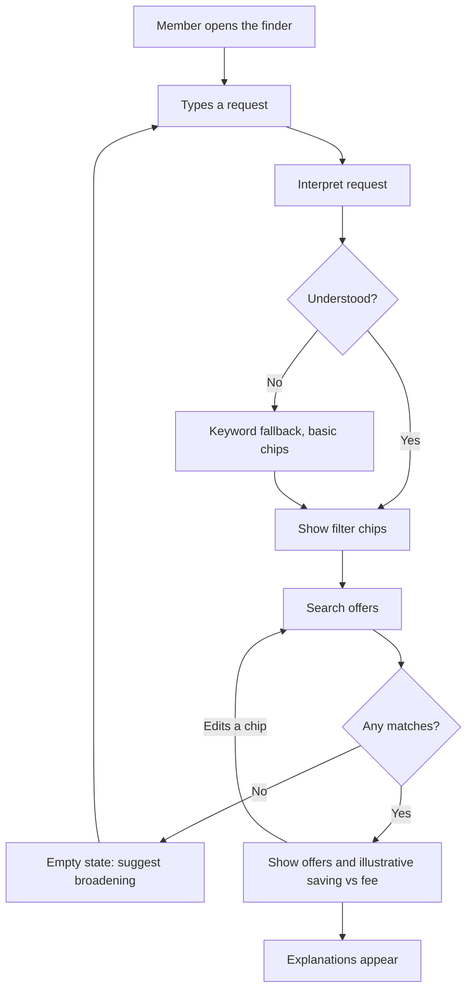
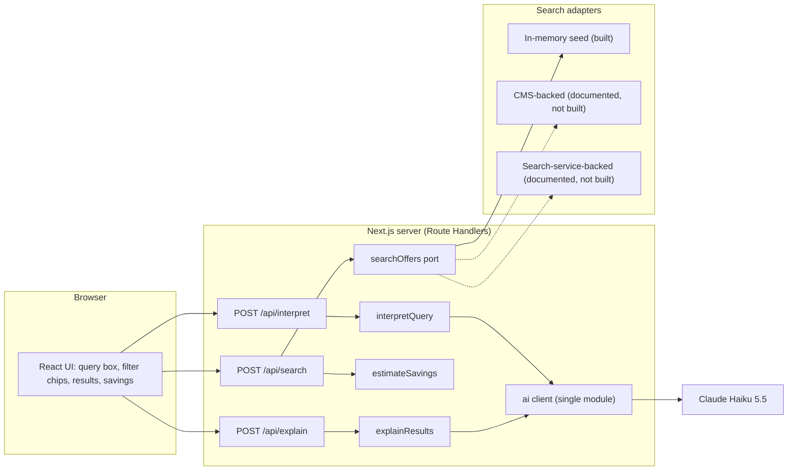

# Architecture

How the finder is built and why. Decisions are recorded in [docs/adr](adr/README.md); this document describes the resulting design.

## Overview

A member types a request in natural language. The app interprets it into editable filters, searches a catalogue deterministically, shows matches with an illustrative saving against the membership fee, and adds short explanations.

The language model only **translates** the query into filters and **explains** results it was given. It never supplies offers, prices or savings ([ADR-002](adr/002-ai-boundary.md)).

## User flow

## System design

## Request flow

## Layers

| Layer | Responsibility | Depends on |
|---|---|---|
| UI (`src/app`) | Input, chips, results, savings, loading, empty and error states | API contracts only |
| Route Handlers (`src/app/api`) | Validate input, orchestrate, shape responses | services |
| Services (`src/services`) | `interpretQuery`, `explainResults`, `searchOffers` port and adapters | domain, `lib/ai` |
| Domain (`src/domain`) | Types, Zod schemas, `estimateSavings`, grounding check. Pure | nothing |
| AI client (`src/lib/ai`) | The only module that calls the model; mock provider for tests | provider SDK |
| Data (`src/data`) | Fictional sample catalogue | domain |

Dependencies point inward: domain depends on nothing, and only `lib/ai` knows the provider.

## Contracts

All requests and responses are validated with Zod at the boundary.

**`Filters`** (output of interpret, input to search):

| Field | Type | Note |
|---|---|---|
| `categories` | list of category | e.g. days out, dining, travel, motoring |
| `region` | string | free text matched against offer regions |
| `maxPricePerPerson` | number | Zod validates range; not expressible in the model's JSON schema |
| `audience` | solo, couple or family | |
| `tier` | standard or plus | |
| `keywords` | list of strings | |

### Offer model

Sample data in `src/data`. Partner names are fictional and terms are labelled sample terms.

| Field | Purpose | Seen in production index? |
|---|---|---|
| `id`, `title`, `partner` | Identity and display | Not applicable (sample) |
| `category` | Category filter | Observed |
| `expiryDate` (optional) | Expired offers hidden by default | Observed |
| `tier` | Standard or Plus availability | Probable (cards adapt to membership level) |
| `region`, `audience`, `typicalPricePerPerson` | Region, audience and budget filters | Not observed; sample only |
| `typicalSavingPerUse`, `assumedUsesPerYear` | Illustrative savings estimate | Not applicable (illustrative) |

**URL state.** Filters are serialised into the URL query string, so a result view is shareable and survives reload.

**Endpoints**

| Endpoint | In | Out | Model call |
|---|---|---|---|
| `POST /api/interpret` | `{ query }` | `{ filters, source: "llm" or "fallback" }` | Yes (1) |
| `POST /api/search` | `{ filters }` | `{ offers, savings }` | No |
| `POST /api/explain` | `{ filters, offerIds }` | `{ explanations: [{ offerId, text }] }` | Yes (1) |
| `GET /api/health` | none | `{ status: "ok", version }` | No |

`/api/explain` takes offer IDs, not offer data. The server reloads the offers from the port, so the client cannot inject content into the prompt.

**Operations.** Each request writes one JSON log line: request ID, endpoint, latency, model calls, token counts, fallback used, outcome, and `PROMPT_VERSION`. Query text is never logged. The app version (`v<package>+<build>.<short sha>`) is shown in the UI footer and returned by `/api/health`. Scope tiers and trade-offs: [roadmap](roadmap.md).

**Savings estimate.** Each offer has `typicalSavingPerUse` and `assumedUsesPerYear` (illustrative sample values). The estimate sums them over the shortlist and compares the total with the tier fee (£45 or £78, from the public site as of 2026-10-14). Always labelled illustrative.

## Failure modes

| Failure | Behaviour |
|---|---|
| Model returns invalid filters | Retry once, then keyword fallback; chips show what was understood |
| Model refuses or is truncated | Treated as invalid; same fallback |
| Explanation cites an unknown offer ID | Rejected; show deterministic match reasons |
| Model or network unavailable | Search still works from keywords and chips; explanations omitted |
| No matches | Empty state suggests broadening; chips remain editable |
| Empty or whitespace input | No model call; the UI prompts for a request |
| Abuse or loops | Input cap, rate limit, provider spend limit ([ADR-006](adr/006-demo-protection.md)) |

## Production path (not built)

Scope tiers, trade-offs and scalability hypotheses are in the [roadmap](roadmap.md). The list below is the data and AI path.

- Replace the in-memory adapter with a search-service-backed adapter ([ADR-004](adr/004-data-layer.md)). The adapter translates typed filters into the service's filter syntax; the model never writes filter strings.
- Fields beyond category, expiry and tier would need index enrichment (for example tagging records at index time) or be handled as free-text query.
- Check whether the search service's own AI features already cover natural-language queries before extending this layer.
- Add query logging only with a data-protection review. Today only query text is sent to the model.
- Measure parse accuracy on real queries; add monitoring and cost alerts.

## Out of scope

Authentication, embeddings, real or scraped data, CMS integration, payments.
