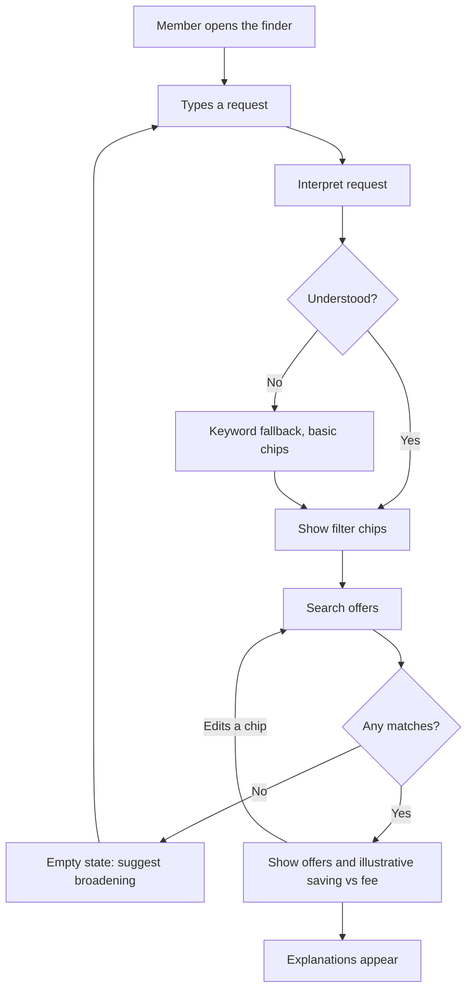
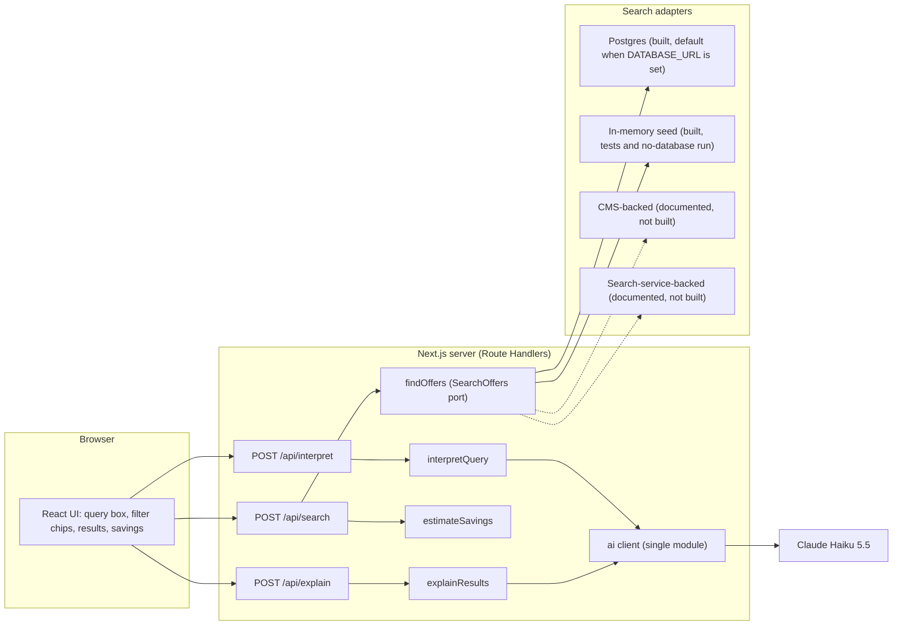
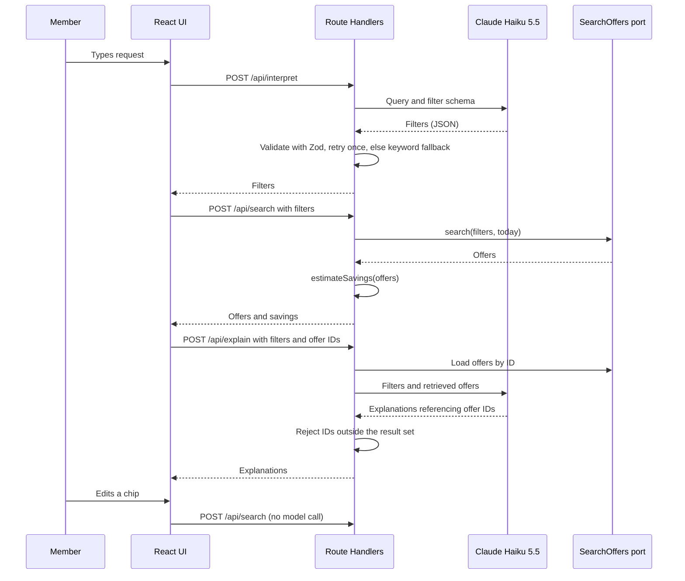

# Architecture

How the finder is built and why. Decisions are recorded in [docs/adr](adr/README.md); this document describes the resulting design.

## Overview

A member types a request in natural language. The app interprets it into editable filters, searches a catalogue deterministically, shows matches with an illustrative saving against the membership fee, and adds short explanations.

The language model only **translates** the query into filters and **explains** results it was given. It never supplies offers, prices or savings ([ADR-002](adr/002-ai-boundary.md)).

## User flow



## System design



## Request flow



## Layers

| Layer | Responsibility | Depends on |
|---|---|---|
| UI (`src/app`) | Input, chips, results, savings, loading, empty and error states | API contracts only |
| Route Handlers (`src/app/api`) | Validate input, orchestrate, shape responses | services |
| Services (`src/services`) | `interpretQuery`, `explainResults`, `findOffers` (calls the `SearchOffers` port) | domain, `lib/ai` |
| Domain (`src/domain`) | Types, Zod schemas, the `SearchOffers` port (an interface only), `estimateSavings`, grounding check. Pure | nothing |
| AI client (`src/lib/ai`) | The only module that calls the model; mock provider for tests | provider SDK |
| Data (`src/data`) | Fictional sample catalogue and the adapters that implement the port (Postgres, in-memory), plus the one place that picks an adapter from the environment | domain |

Dependencies point inward: domain depends on nothing, and only `lib/ai` knows the provider. Next.js-specific conventions (server-only modules, env access, route states) are in [ADR-009](adr/009-nextjs-conventions.md); the import boundaries above are enforced by Oxlint.

## Folder structure

Target layout. Folders are created when they get content ([ADR-009](adr/009-nextjs-conventions.md) rule 2), so most of this does not exist yet. Parts marked *proposal* go beyond ADR-009 and are confirmed in the Phase 0 and Phase 1 plans.

```text
boundless-tech-test/
|-- .agents/skills/              task workflow skills (exists); .claude/skills links here
|-- .github/workflows/ci.yml     typecheck, lint, unit, e2e, integration (Postgres service)
|-- db/migrations/               plain SQL migrations, applied by node-pg-migrate
|-- docs/                        brief, adr, research, design, architecture, roadmap, TODO (exists)
|-- e2e/                         Playwright: two happy-path specs (proposal)
|-- evals/                       cases and run script, on demand, real model (proposal)
|-- scripts/                     seed script, run with tsx
|-- src/
|   |-- app/                     routes and Route Handlers only
|   |   |-- layout.tsx, page.tsx, globals.css
|   |   |-- loading.tsx, error.tsx, not-found.tsx, global-error.tsx
|   |   |-- _components/         route-specific UI: query box, filter chips, offer list, savings panel
|   |   `-- api/
|   |       |-- interpret/route.ts
|   |       |-- search/route.ts
|   |       |-- explain/route.ts
|   |       `-- health/route.ts
|   |-- components/              shared UI, only when a second route needs it
|   |-- domain/                  pure: types, Zod schemas, SearchOffers port, estimateSavings, grounding check
|   |-- services/                interpretQuery, explainResults, findOffers (server-only)
|   |-- lib/
|   |   |-- ai/                  the only code that calls the model: client, provider, mock (server-only)
|   |   |-- env.ts               the only reader of process.env
|   |   `-- log.ts               the one-line JSON request log (proposal)
|   `-- data/                    sample catalogue, adapters, adapter selection (server-only)
|-- AGENTS.md, DESIGN.md, README.md
|-- compose.yaml                 local Postgres for dev and integration tests (Podman or Docker)
|-- .env.example                 dev-only values, no secrets
`-- package.json, tsconfig.json, next.config.ts, oxlint and oxfmt config, vitest config, playwright config
```

Conventions inside `src/`, from ADR-009: components are `PascalCase.tsx`, all other files `kebab-case.ts`, and the import boundaries are enforced by Oxlint.

Proposals:
- Unit tests sit beside the code as `*.test.ts`. Integration tests sit beside it as `*.integration.test.ts` and run with `pnpm test:integration`, against their own database: the `postgres-test` Compose service (port 5433, in-memory storage), so they never touch the dev data that `pnpm db:seed` loads. The Vitest global setup migrates it first; `TEST_DATABASE_URL` overrides its URL (for CI). The contract test suite for the port lives with the port in `src/domain` and is imported by each adapter's integration test.
- `src/data` holds the sample catalogue module, one file per adapter, and a single `index.ts` that returns the adapter for the current environment: Postgres when `DATABASE_URL` is set, in-memory otherwise. It is built on first use and reused, so a server process holds one connection pool (with an `error` listener, so a failed idle connection cannot crash the process). Nothing else chooses an adapter. Unit tests blank `DATABASE_URL`, so they always use the in-memory adapter.
- The Tailwind theme mirrors the tokens in [DESIGN.md](../DESIGN.md).

Decided in Phase 1:
- `scripts/` run outside Next.js with `tsx --conditions=react-server`, set in their `pnpm` scripts. `tsx` resolves the `@/` paths from `tsconfig.json`, and the `react-server` condition makes `server-only` resolve to its empty module, which is the mechanism that package provides. So the seed script imports the sample catalogue from `src/data` unchanged, and ADR-009 rule 5 holds. Rejected: removing `server-only` from the catalogue (breaks rule 5), a custom loader alias like the Vitest stub (more code for the same result), and running the seed through Vitest (misuses the test runner). The condition applies to the whole script process, so any package with a `react-server` export would load its server build; scripts import no React, so this is accepted. Scripts are developer-run code, and bypassing the guard there is deliberate. Scripts do not import `src/lib/env.ts` (it requires the build-time version); each parses its own `DATABASE_URL` with Zod. `tsx` is a pinned dev dependency; its `esbuild` build script is not allowed (`allowBuilds` in `pnpm-workspace.yaml`), as the platform binary ships as an optional dependency. The seed script imports `@/data/sample-catalogue` and `@/data/postgres-search-offers` directly, not `@/data`, so it never depends on adapter selection.
- Migrations are plain SQL files in `db/migrations/`, applied by `node-pg-migrate` (`pnpm db:migrate`, its own CLI, which reads `DATABASE_URL` from the shell). The driver is `pg` (node-postgres). Chosen in the Phase 1 Postgres plan (2026-10-15): node-pg-migrate reads SQL from a configurable directory and tracks applied migrations with a lock. Rejected: `postgres` (postgres.js), whose migration tool wants a folder per migration; `dbmate`, a downloaded binary; a hand-written runner, which would own tracking and locking; and `@neondatabase/serverless`, which speaks HTTP and needs a proxy for local Postgres. `@netlify/database` depends on `pg`, which suggests `pg` fits the hosted option; not verified until the optional deploy.

## Contracts

All requests and responses are validated with Zod at the boundary.

**`Filters`** (output of interpret, input to search):

| Field | Type | Note |
|---|---|---|
| `categories` | list of category | `days-out`, `dining`, `shopping`, `travel`, `motoring`, `events` (a simplified set, from the public site as of 2026-10-14); de-duplicated |
| `region` | string | free text matched against offer regions |
| `maxPricePerPerson` | number | Zod validates range; not expressible in the model's JSON schema |
| `audience` | solo, couple or family | |
| `tier` | standard or plus | |
| `keywords` | list of strings | de-duplicated case-insensitively, first spelling kept |

### `SearchOffers` port

The only way services reach the catalogue. It is an interface in `src/domain`; adapters in `src/data` implement it. It is async because the Postgres adapter is.

| Operation | In | Out | Used by |
|---|---|---|---|
| `search` | `Filters` and `today` (an ISO date, supplied by the service) | ranked `Offer[]` (empty list when nothing matches, never an error) | `/api/search` |
| `getByIds` | list of offer IDs | `Offer[]` | `/api/explain` |

The model never reaches the port. Adapters translate typed filters into their own query form; no adapter accepts query strings from the model.

Behaviour every adapter must share, written as one contract test suite (`src/domain/search-offers.contract.ts`) run against each adapter. All rules are Decided (Phase 1 plan, 2026-10-15); each is a judgement, not evidence from the production index.

| Behaviour | Rule |
|---|---|
| Combining filters | Every supplied filter must match (and); an absent or empty filter is no constraint |
| `categories` | Any-of. An offer has a single category, so all-of could never match two |
| `tier` | The member's tier: `standard` returns Standard offers only; `plus` returns Standard and Plus offers; absent returns all. Basis: the company profile lists Standard benefits under both tiers |
| `audience` | The offer's audience list contains the value |
| `region` | Trimmed, case-insensitive equality. Offers with region `UK-wide` match every region filter. No substring or alias matching |
| `maxPricePerPerson` | Inclusive: `typicalPricePerPerson <= max`. Price is required, so a free offer has price `0` and passes every limit |
| `keywords` | Any-of; case-insensitive substring over `title` and `partner` only, each field searched on its own (no match across the two). `Filters` removes repeated keywords, so each distinct keyword counts once toward ranking |
| Expiry | Offers with `expiryDate < today` are hidden; an offer is valid through its expiry date. There is no option to include expired offers |
| Clock | `today` is an argument, so adapters read no clock and tests need no fake timers |
| Ranking | Keywords matched (more first), then estimated annual saving `typicalSavingPerUse × assumedUsesPerYear` (higher first), then `id` ascending. Annual saving is compared in whole pence so adapters cannot disagree on float ties |
| `getByIds` | Known offers, each once, ordered by `id` ascending; unknown IDs omitted; expired offers still returned (a lookup, not a search) |

A search-service-backed adapter would support only the fields evidenced in that index ([ADR-004](adr/004-data-layer.md) evidence; category, expiry and probably tier). That limit belongs to the adapter, not the port.

### Offer model

Sample data in `src/data`. Partner names are fictional and terms are labelled sample terms.

| Field | Purpose | Seen in production index? |
|---|---|---|
| `id`, `title`, `partner` | Identity and display | Not applicable (sample) |
| `category` | Category filter | Observed |
| `expiryDate` (optional) | Expired offers hidden by default | Observed |
| `tier` | Standard or Plus availability | Probable (cards adapt to membership level) |
| `region`, `audience`, `typicalPricePerPerson` | Region, audience and budget filters. `audience` is a non-empty list (an offer can suit several audiences); money is in pounds with at most two decimals | Not observed; sample only |
| `typicalSavingPerUse`, `assumedUsesPerYear` | Illustrative savings estimate | Not applicable (illustrative) |

**URL state.** Filters are serialised into the URL query string, so a result view is shareable and survives reload.

**Endpoints**

| Endpoint | In | Out | Model call |
|---|---|---|---|
| `POST /api/interpret` | `{ query }` | `{ filters, source: "llm" or "fallback" }` | Yes (1) |
| `POST /api/search` | `{ filters }` | `{ offers, savings }` | No |
| `POST /api/explain` | `{ filters, offerIds }` | `{ explanations: [{ offerId, text }] }` | Yes (1) |
| `GET /api/health` | none | `{ status: "ok", version }` | No |

`/api/explain` takes offer IDs, not offer data. The server reloads the offers from the port, so the client cannot inject content into the prompt.

**Operations.** Each request writes one JSON log line: request ID, endpoint, latency, model calls, token counts, fallback used, outcome, and `PROMPT_VERSION`. Query text is never logged. The app version (`v<package>+<build>.<short sha>`) is shown in the UI footer and returned by `/api/health`. Scope tiers and trade-offs: [roadmap](roadmap.md).

**Errors and request checks.** Route Handlers reject a wrong content type or an oversized body before parsing (the limit is set in config, a heuristic), then validate with Zod. Every endpoint returns the same error shape for invalid requests and unexpected server errors: `{ error: { code, message, requestId } }` with an HTTP status. Messages are safe to show and carry no internals; `code` comes from a small closed set defined in `src/domain`, finalised in Phase 3. A model failure is not an error response: it triggers the fallback described below, and `/api/interpret` reports `source: "fallback"`.

**Savings estimate.** Each offer has `typicalSavingPerUse` and `assumedUsesPerYear` (illustrative sample values). `estimateSavings` in `src/domain/savings.ts` gives each offer's yearly saving (per-use saving × uses), then, for each tier, the total of the offers that tier can use (Standard counts Standard offers, Plus counts all, as in the port's tier rule) and its margin against the tier fee (`MEMBERSHIP_FEES_PENCE`: £45 or £78, from the public site as of 2026-10-14). A negative margin means the offers do not cover the fee. It also returns the highest tier total for the "up to" badge. All amounts are whole pence, so sums are exact; the UI formats pounds. The result has a Zod schema, `SavingsEstimate`, for the `/api/search` response. Always labelled illustrative.

## Failure modes

| Failure | Behaviour |
|---|---|
| Model returns invalid filters | Retry once, then keyword fallback; chips show what was understood |
| Model refuses or is truncated | Treated as invalid; same fallback |
| Model call exceeds the timeout | Aborted and counted as the failed attempt: retry once, then keyword fallback. Worst case is two timeouts. The timeout is set in config and starts as a heuristic, to be tuned from logged latency |
| Explanation cites an unknown offer ID | Rejected; show deterministic match reasons |
| Model or network unavailable | Search still works from keywords and chips; explanations omitted |
| No matches | Empty state suggests broadening; chips remain editable |
| Empty or whitespace input | No model call; the UI prompts for a request |
| Abuse or loops | Input cap always; rate limit and provider spend limit if deployed ([ADR-006](adr/006-demo-protection.md), [ADR-011](adr/011-local-first-delivery.md)) |

## Production path (not built)

Scope tiers, trade-offs and scalability hypotheses are in the [roadmap](roadmap.md). The list below is the data and AI path.

- Add a search-service-backed adapter beside the Postgres and in-memory adapters ([ADR-010](adr/010-postgres-data-layer.md)). The adapter translates typed filters into the service's filter syntax; the model never writes filter strings.
- Fields beyond category, expiry and tier would need index enrichment (for example tagging records at index time) or be handled as free-text query.
- Check whether the search service's own AI features already cover natural-language queries before extending this layer.
- Add query logging only with a data-protection review. Today only query text is sent to the model.
- Measure parse accuracy on real queries; add monitoring and cost alerts.

## Out of scope

Authentication, embeddings, real or scraped data, CMS integration, payments.
